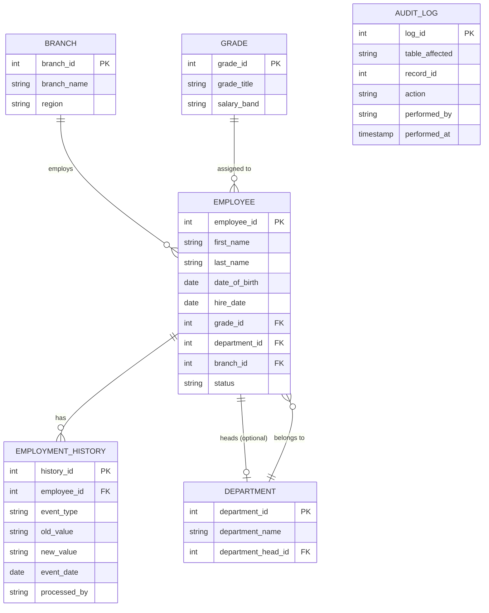

# ER Diagram — PrimeTrust Bank HR Management System

This renders automatically when viewed on GitHub (Mermaid support is native
in GitHub's Markdown renderer — no extra tool needed). If your lecturer wants
an image file too, paste this block into the Mermaid Live Editor
(https://mermaid.live) and export as PNG/SVG into this folder as `er-diagram.png`.

## Notes on relationships

- **Branch → Employee** (1:M): each branch employs many staff; each employee
  belongs to exactly one branch.
- **Grade → Employee** (1:M): each grade is held by many employees.
- **Department → Employee** (1:M): standard reporting-line membership.
- **Employee → Department** (1:1, optional, circular reference): a department
  is *headed by* one employee. This is the one deliberately circular FK in the
  schema — `department.department_head_id` points to `employee`, while
  `employee.department_id` points back to `department`. Handled in
  `schema.sql` by creating `department` first without the FK, then adding it
  with `ALTER TABLE` once `employee` exists. `audit_log` is intentionally
  **not** linked by a formal FK to every table (it stores `table_affected` +
  `record_id` instead) — this is a common trade-off for a generic, reusable
  audit trail, and worth a sentence in your reflection.
