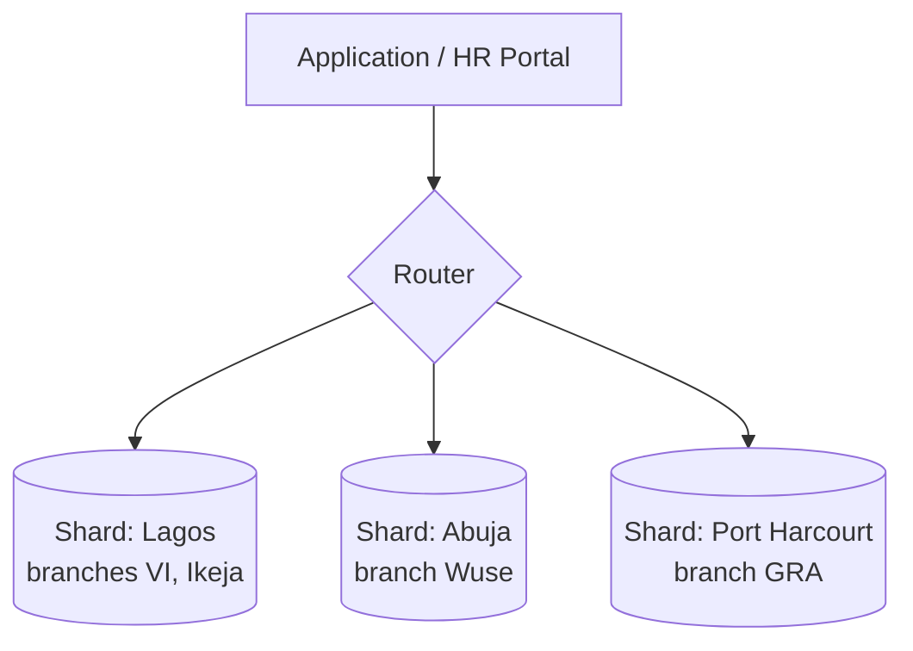
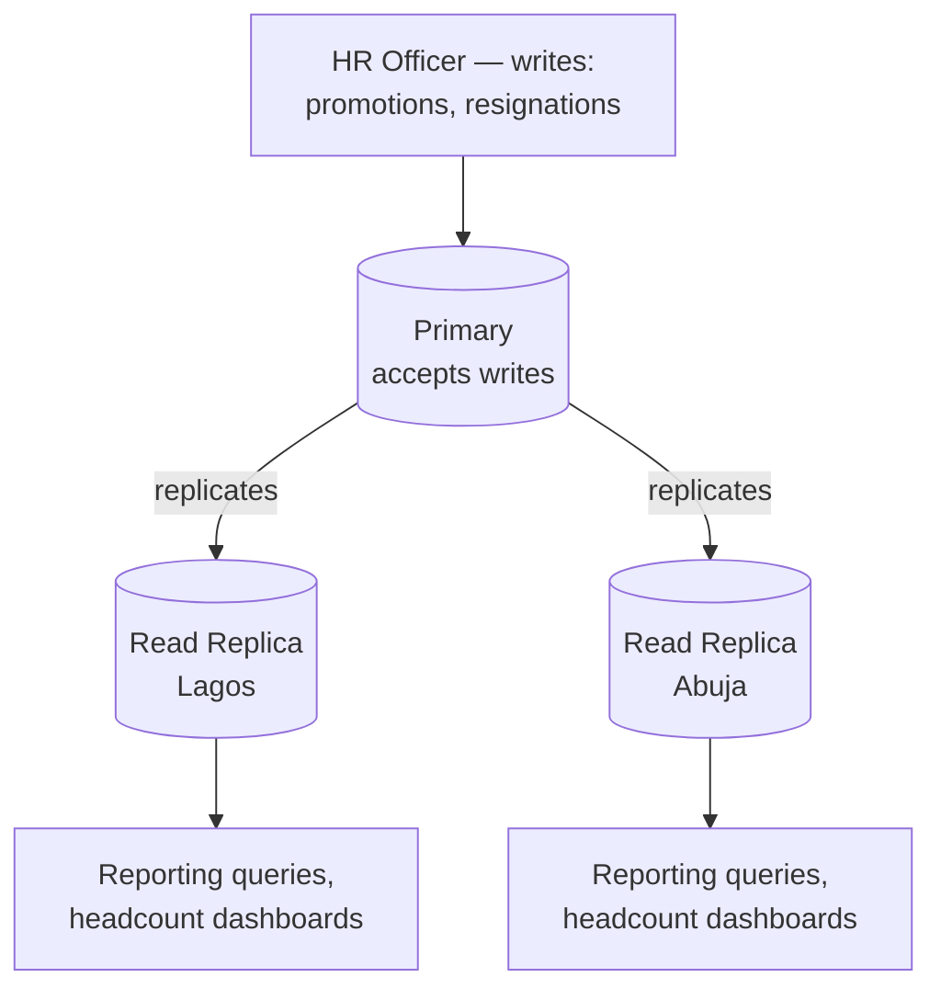

# Distributed and Cloud Database Discussion-PrimeTrust Bank HR

PrimeTrust Bank operates across multiple regions (Lagos, Abuja, Port
Harcourt - see `branch.region` in the schema). This naturally motivates
a discussion of how the HR database would need to scale and stay
available as the bank grows to more branches and regions.

## 1. Sharding by region

**Concept:** instead of one database holding every employee row, split
(shard) the `employee` table by `branch.region`, so each region's HR data
lives on its own database node.

**Why this fits the case study:** most day-to-day HR queries are
naturally region-scoped - a branch manager in Lagos looking up their own
staff doesn't need to touch Abuja's data at all. Sharding by region means
most queries only ever hit one shard, keeping them fast as the bank adds
more branches.

**The cost of this choice:** a query that spans regions - e.g. "headcount
per department, bank-wide" (Portfolio 2's Q3) now has to query every
shard and merge the results in the application layer, rather than a
single `GROUP BY`. This is the classic trade-off of sharding: faster
region-scoped reads, more complex cross-region aggregates.

**Sharding key choice:** `region` (or `branch_id`) is a better shard key
than, say, `employee_id`, because it keeps each branch's data physically
together, an employee's full profile, history, and department context
all live on the same shard, avoiding cross-shard joins for the most
common query pattern (look up one employee's full record).

## 2. Replication

**Concept:** rather than splitting data *apart* (sharding), replication
*copies* the same data to multiple nodes - one primary that accepts
writes, and one or more read replicas that serve read-only queries.

**Why this fits the case study:** HR reporting (headcount dashboards,
audit queries, Portfolio 2's analytical queries) is read-heavy and
doesn't need split-second freshness. Writes (promotions, resignations -
Portfolio 3's transactions) are comparatively rare and must stay strongly
consistent. Routing reports to read replicas keeps that reporting load
off the primary, which stays free to handle the transactional writes HR
officers make throughout the day.

**MySQL mechanism:** MySQL supports this natively via binary log (binlog)
replication - the primary logs every write, and replicas apply the same
log to stay in sync, either asynchronously (faster writes, replicas can
lag slightly) or semi-synchronously (primary waits for at least one
replica to acknowledge before confirming a write, trading a little write
latency for a stronger durability guarantee).

## 3. CAP theorem trade-offs

The CAP theorem says a distributed system can only fully guarantee two of
three properties during a network partition: **C**onsistency,
**A**vailability, **P**artition tolerance. Partition tolerance isn't
really optional in a real multi-region deployment, so the real choice is
between **C** and **A** when a partition happens.

**For PrimeTrust's HR data, consistency should usually win over
availability.** Concrete reasoning tied to the case study:

- A **promotion or grade change** (Portfolio 3) directly affects payroll.
  If a network partition caused two regions to briefly disagree about an
  employee's current grade, and the system favoured availability
  (letting both regions keep accepting writes independently), you risk a
  genuine payroll error - paying someone at the wrong grade, or worse, a
  lost-update style conflict once the partition heals.
- A **resignation record** (soft delete via `status`) needs to be
  consistent system-wide - an employee who has resigned should not still
  show as active and able to, say, approve transactions in a different
  region's system during a partition.
- By contrast, something like a **read-only headcount dashboard** can
  reasonably tolerate slightly stale data during a partition - this is
  exactly what the read-replica architecture above already assumes
  (replicas can lag a little; that's an accepted trade-off for reporting
  queries specifically, not for the write path).

**Conclusion:** PrimeTrust's design leans toward **CP** (consistency +
partition tolerance) for the transactional core - using a single
authoritative primary per write, strong replication guarantees, and
accepting that writes may briefly fail or queue during a partition rather
than risk two conflicting versions of payroll-critical data. The **read
replica layer for reporting** is where the system deliberately trades a
little consistency for availability and read performance, because the
cost of serving a slightly stale dashboard is low compared to the cost of
serving a slightly wrong payroll grade.

